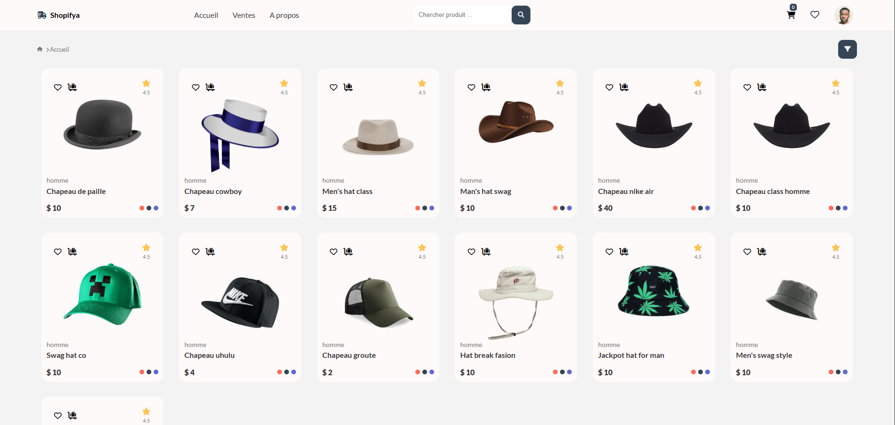

# 🛍️ Shopifya — E-Commerce Vanilla JavaScript (DOM)

> Une application e-commerce moderne, élégante et interactive, développée en HTML, CSS et JavaScript pur en exploitant la manipulation dynamique du DOM.

---

## 📸 Aperçu du projet

<div align="center">
  
</div>

---

## 🚀 À propos du projet

**Shopifya** est une application web e-commerce interactive conçue pour mettre en pratique la manipulation avancée du DOM en JavaScript. Elle simule une boutique en ligne fluide dédiée à la mode (chapeaux, accessoires) avec :

- 🔍 **Recherche et filtrage en temps réel** des produits directement via le DOM.
- ❤️ **Gestion des favoris** et des interactions dynamiques.
- 🛒 **Panier d'achat interactif** avec mise à jour instantanée des prix et des articles.
- 📱 **Interface responsive** soignée et agréable.

---

## 🛠️ Stack Technique

<p align="left">
  <!-- HTML5 -->
  <a href="https://developer.mozilla.org/fr/docs/Web/HTML" target="_blank" rel="noreferrer">
    
  </a>
  &nbsp;&nbsp;
  <!-- CSS3 -->
  <a href="https://developer.mozilla.org/fr/docs/Web/CSS" target="_blank" rel="noreferrer">
    
  </a>
  &nbsp;&nbsp;
  <!-- JavaScript -->
  <a href="https://developer.mozilla.org/fr/docs/Web/JavaScript" target="_blank" rel="noreferrer">
    
  </a>
  &nbsp;&nbsp;
  <!-- Git -->
  <a href="https://git-scm.com/" target="_blank" rel="noreferrer">
    
  </a>
</p>

_Le projet repose entièrement sur les technologies web fondamentales : **HTML5**, **CSS3** et **JavaScript (DOM API)** sans framework externe._

---

## ⚙️ Installation et Lémarrage Rapide

Assurez-vous d'avoir **Git** installé sur votre machine. Copiez et exécutez la commande unique ci-dessous dans votre terminal pour cloner le projet et l'ouvrir :

```bash
git clone [https://github.com/tchoupo237/Shopifya.git](https://github.com/tchoupo237/Shopifya.git) && cd Shopifya

```

> Lancement de l'application :
> Puisque c'est un projet statique (HTML/CSS/JS), vous pouvez simplement :

Ouvrir le dossier du projet dans VS Code.

Utiliser l'extension Live Server pour lancer le fichier index.html en local.

Ou double-cliquer directement sur le fichier index.html pour l'ouvrir dans votre navigateur web.

👤 Auteur
Tchoupo Christian (WEB 3.0 ACADEMY)

Étudiant en Génie Logiciel & Développeur Full-Stack

GitHub : @tchoupo237
